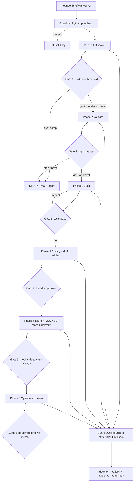

# VentureGate architecture

## Overview

VentureGate is six single-purpose agents wrapped in deterministic Python; to the founder they speak as one AI cofounder, Steve. The code decides, not the model: a guard checks every input and every output, a gate with pre-registered thresholds ends every phase, and an approval layer raises an exception on any publish, send or spend action the founder has not approved. The model only writes content; it never decides whether to continue, and it never sees a way to change a threshold. Every action is appended to `decision_log.json`, and every factual claim to `evidence_ledger.json` as SOURCED (with a real URL) or ASSUMPTION.



## Phases

| Phase | Agent | Tools | Gate | Outputs |
|---|---|---|---|---|
| 1 Discover | `discover` | local model, `sources/` | G1 evidence | intake, opportunities + verdict, market fit, improvements + IP checklist, costs + runway, Mom Test script |
| 2 Validate | `validate` | local model, mocks | G2 demand | lean canvas, landing page draft, `[SIMULATED]` demand, detailed plan |
| 3 Build | `build` | local model, MVP tests | G3 tests | working MVP, user docs, test report |
| 4 Commercial setup | `commercial` | local model, cost arithmetic | G4 commercial | pricing options + break-even, DRAFT policies |
| 5 Launch | `launch` | local model, mock events | G5 sale-to-cash | store page, launch posts, `payment_test_log.md` |
| 6 Operate and learn | `operate` | mocks, cost data | G6 memo | support drafts, metrics, persevere-or-pivot memo |

### Phase 1 Discover

**Core step: find opportunities.** Agent `discover`; tools: local model, saved sources in `sources/`, cost arithmetic in `costs.py`.

1. **Intake**: restates the idea for the founder to confirm and flags anything that is not a digital product or falls in an excluded category.
2. **Opportunities and verdict**: compares the founder's idea with at least two alternative angles, scores demand, room against competitors and founder fit (the total is added up in code), names competitors from the sources, and gives a verdict of strong, promising, weak or not viable, with reasons.
3. **Market fit**: rates demand, competition, culture, regulation, language and purchasing power for the target market. If the brief has no target market, the founder is asked first.
4. **Improvements and IP check**: up to three improvements, then a checklist covering trademark, copyright and licensing, platform terms, patents, and exclusive rights or regulation, marked clear, risk or unknown, with the disclaimer "This is not legal advice". Skill gaps are marked blocking or not.
5. **Costs and runway**: the model lists one-off and monthly costs with sources; code computes the totals, the months the budget covers, the money needed for the planning period, and the break-even condition `ceil(C / P)`. No income figure is ever produced.
6. **Interview script**: a Mom Test script. Code rejects hypothetical questions ("would you pay...") and the model never writes answers. The interviews themselves are STUBBED: the founder runs them.

Output: `phase1_step1` to `phase1_step6`, claims in `evidence_ledger.json`, then Gate 1.

### Phase 2 Validate

**Core step: design the business.** Agent `validate`; tools: local model, `[SIMULATED]` fixtures.

1. **Lean Canvas**: the nine blocks; the pricing model is described in words, without amounts.
2. **Landing page draft**: HTML with a waitlist form that is MOCKED and collects nothing.
3. **Demand signals**: no model is involved. The sign-ups and audience preference come from the fixture named in the brief and are labelled `[SIMULATED]` everywhere.
4. **Detailed plan** (only after Gate 2 and the founder's final confirmation): seven areas, from finding the opportunity to operating and learning, each with steps, at most the three best options with cost, time and trade-offs, the tools, and what the founder approves.

### Phase 3 Build

**Core step: build the product.** Agent `build`; tools: local model, `mvp.py`.

The model writes three to six items of real product content plus user docs. Code renders them into a self-contained HTML product with a downloadable Markdown bundle, escaping all model text so nothing it writes can run, and then runs 14 automatic checks: every item rendered, at least 25 words each, contents links resolve, no placeholder text, no stray scripts, the guard passes, the docs are complete. Gate 3 needs every check to pass; failures are fed back to the model by name. Content products (templates, guides, checklists) are built; software MVPs beyond a static page are STUBBED.

### Phase 4 Commercial setup

**Core step: set the price and policies.** Agent `commercial`; tools: local model, `costs.py`. No payments of any kind.

1. **Pricing**: up to three options; code adds the break-even condition for each one against the Phase 1 monthly costs. The founder approves the price.
2. **Policies**: Terms of Service, Privacy Policy and Refund Policy. Code labels each "DRAFT - not legal advice"; Gate 4 checks the label is there.

### Phase 5 Launch

**Core steps: open the store; deliver automatically.** Agent `launch`; tools: local model, `delivery.py`, `refunds.py`, `reconcile.py`.

1. **Store page**: an HTML draft at the approved price. Opening the store needs the founder's approval.
2. **Launch posts**: two or three drafts, each with a `<STORE_LINK>` placeholder. Publishing needs approval and is MOCKED: nothing is posted.
3. **Automatic delivery**: the MOCKED sale-to-cash flow below, written to `outputs/payment_test_log.md`.

### Phase 6 Operate and learn

Agent `operate`; tools: local model, `[SIMULATED]` fixtures, the cost data.

1. **Support**: a reply to each simulated ticket. Sending needs approval and is MOCKED.
2. **Metrics**: simulated demand and support signals next to the real cost data; no income figures.
3. **Persevere-or-pivot memo**: Gate 6 calculates go (persevere), pivot or stop first; the model then explains that decision and may not soften it.

### How agents are kept honest

- **Sources cannot be invented.** The model sees excerpts labelled `[S1]`..`[Sn]` and may cite only those labels; code maps a label to its URL. A label that does not resolve makes the claim an ASSUMPTION, noted in the output.
- **Sources are fenced as evidence.** Instructions hidden inside a saved page are treated as text, not commands.
- **Every output passes the guard.** A rejected draft is redone with the guard's findings, at most three attempts, then the step fails loudly. Claims from a rejected draft never reach the evidence ledger.
- **Replies are checked.** Each reply must match a JSON schema plus code checks (no repeated options, all five IP areas, each ticket answered once). A malformed reply is retried with the error attached.

## Gates

Thresholds live in `gates.yaml`, are loaded once at the start of a run and fingerprinted; any change to the file or the loaded values during a run raises `ThresholdLocked`. Gates return **go**, **repeat**, **pivot** or **stop**, calculated from numbers — never from the model's opinion. A failed evidence gate can never be overridden into go: the founder may accept stop or pivot, or revise the idea and run again.

| Gate | Pass condition | On failure |
|---|---|---|
| G1 Discover | ≥3 alternatives compared, ≥5 claims with real source URLs, founder fit (budget covers the planning period, enough weekly hours, no blocking skill gap) | pivot, or stop when the founder does not fit |
| G2 Validate | `[SIMULATED]` sign-ups reach the pre-set target, plus founder approval | stop below half the target, otherwise pivot |
| G3 Build | all MVP tests pass and user docs exist | repeat, max 3, then stop |
| G4 Commercial setup | Terms, Privacy and Refund drafts all labelled "DRAFT - not legal advice", price approved | repeat |
| G5 Launch | MOCKED sale-to-cash flow passes every check | repeat |
| G6 Operate | memo built from labelled signals and cost data, no income figures | go (persevere), pivot or stop |

**When the system recommends STOP.** G2 is the headline case: a pre-set target of 100 sign-ups in 14 days against 12 actual `[SIMULATED]` sign-ups is 12% of target, below the stop line, so the system writes an unsoftened STOP report saying the demand evidence is weak and listing what would change the decision. It does not spin the result, and it does not offer to continue anyway.

## Sale to cash

Entirely MOCKED: no payment library, no sandbox, no money, fake IDs only.

1. **Payment triggers delivery** — a mock `order_paid` event makes `delivery.py` grant access (a licence record in a local JSON store).
2. **A refund revokes access** — a mock `order_refunded` event makes `refunds.py` revoke that buyer's licence.
3. **Idempotency** — every event carries an `idempotency_key`; a repeated event is ignored, so a retry never delivers twice.
4. **Reconciliation** — `reconcile.py` matches orders, mock payment records, mock fee records and mock payout records **by ID and status**, reporting matched, refunded-and-revoked, and problems.

Amount-level reconciliation (gross, fees, net payout) is **STUBBED**: this system reports no money amounts anywhere, so those figures would come from the founder's own payment provider, outside VentureGate. Delivery is also refused until the founder has approved opening the store. Test runs are written to `outputs/payment_test_log.md`.

## Data flow

```
founder brief
   -> guard.pre_check            (refuse banned requests; log the refusal)
   -> agent + llm                (local model; sources are excerpts labelled [S1]..[Sn])
   -> guard.post_check           (no income figures, no fake social proof; every claim sourced or ASSUMPTION)
   -> outputs/phase<N>_step<M>_<run>-<name>.md
   -> founder confirmation       (approve, or reject with changes)
   -> gates.evaluate             (go / repeat / pivot / stop, from gates.yaml)
   -> approval.require_approval  (publish / send / spend only)
   -> decision_log.json + evidence_ledger.json
```

**Founder control in practice.** The orchestrator is a generator: it yields a request and waits. The
founder console (`app.py`, a local Gradio page) and the command line both answer the same requests, so
there is no path through the pipeline that skips a decision. Approvals are recorded with
`approved_by: "founder"`; publishing, sending and opening the store are each separate, explicit
approvals, and all three are MOCKED.

## Built vs. stubbed

| Component | Status |
|---|---|
| logger, ledger, guard, gates, approval, model layer | Built |
| mocks, delivery, refunds, reconciliation (on mock events) | Built |
| six phase agents, prompts, source mapping, MVP builder | Built |
| orchestrator, founder console (Gradio page), command line, red-team report | Built |
| customer interviews | STUBBED — script only, founder runs them |
| amount-level reconciliation | STUBBED |
| store, sale, delivery, publishing, sending | MOCKED |

## Roadmap

- Optional free-tier hosted open-weight model with automatic fallback to the local one.
- More founder languages beyond English and Arabic.
- Pluggable phase agents, so a contributor can add a phase as a prompt plus a file.
- Importing real interview notes and a real waitlist export to replace the simulated demand fixtures.
